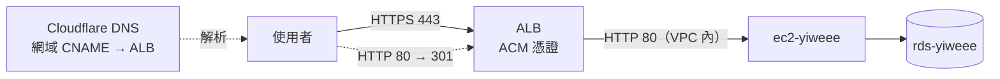
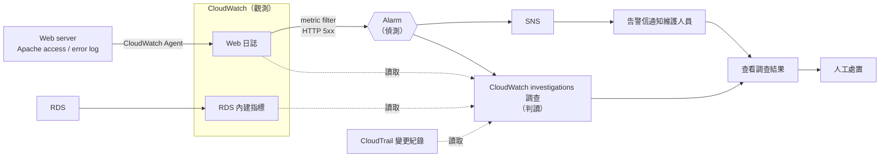

# P0-2 | WordPress Web/DB 分離（多組件經典架構）

---

## 目標

實現 EC2 + RDS 的 web/db 分離架構，並完成下方檢核點項目。

## 核心檢核點

1. VPC 切出 public / private 兩個 subnet
2. Web 在 public，外部瀏覽得到網站
3. DB（RDS 或自架 MySQL）在 private，外網連不到（此條最能驗證真的懂分離）
4. SG 串接：只允許 Web 的 SG 連 DB:3306
5. 發一篇文章、重整後仍在（確認寫入 DB）
6. 網站以 HTTPS 提供（ALB + ACM），HTTP 自動轉導 HTTPS，EC2 不能繞過 ALB 直接被連

## 技術棧

| 類別     | 技術                                                       |
| -------- | ---------------------------------------------------------- |
| 雲端平台 | AWS（ap-northeast-1）                                      |
| 網路     | VPC、Subnet、Internet Gateway、Route Table、Security Group |
| 加密     | Application Load Balancer、ACM（DNS 驗證）、Cloudflare DNS |
| 運算     | EC2 t3.micro（Ubuntu 22.04 LTS）                           |
| 資料庫   | RDS for MySQL 8.0（db.t3.micro，20 GB）                    |
| 應用     | WordPress、Apache、PHP、MySQL client 8.0                   |
| 存取     | SSM Session Manager、IAM role                              |
| IaC      | Terraform（`aws`、`cloudflare` provider）、user_data       |

## 架構說明

### 網路設定

1. 建立一個 VPC (vpc-yiweee)，CIDR 設定為 `10.0.0.0/16`。
2. VPC 下切出 public 兩個、private 兩個共計四個網段，名稱分別為 subnet-yiweee-public-1a(`10.0.1.0/24`)、subnet-yiweee-public-1c(`10.0.4.0/24`)、subnet-yiweee-private-1a(`10.0.2.0/24`)、subnet-yiweee-private-1c(`10.0.3.0/24`)。public-1c 只是為了滿足 ALB 必須橫跨兩個 AZ 的要求，不放 EC2。
3. public 網段的 `0.0.0.0/0` 指向 IGW，並啟動內部機器自動配發對外 IP；private 網段只有 VPC 內的 local 路由，不對外。

### HTTPS（ALB + ACM）



1. 網域的 DNS 託管在 Cloudflare，網域名稱與 API token 寫在 `*.tfvars`（`domain_name`、`cloudflare_api_token`）。token 只需要該網域的 `Zone:Read` 與 `DNS:Edit`。
2. 用 ACM 申請網域憑證，以 DNS 驗證：Terraform 在 Cloudflare 自動建立驗證用的 CNAME，等憑證簽發完成後 ALB 才掛上去，整個過程不需人工操作。
3. ALB（alb-yiweee）放在 public-1a 與 public-1c。listener 443 掛 ACM 憑證並轉送到 target group（EC2 的 80）；listener 80 一律以 301 轉導 HTTPS。
4. TLS 在 ALB 終止，ALB 到 EC2 之間在 VPC 內走 HTTP，此為已知取捨。
5. 網域以 CNAME 指向 ALB，並設為「僅 DNS」（不經 Cloudflare 代理），讓使用者直連 ALB、看到的是 ACM 憑證。
6. `wp-config.php` 將 `WP_HOME`、`WP_SITEURL` 固定為 `https://<網域>`，並信任 ALB 帶來的 `X-Forwarded-Proto`，否則 WordPress 會把請求判成 HTTP 而無限轉導。
7. ALB 的 idle timeout 調為 120 秒：故障演練時 WordPress 約等 60 秒才回 500，預設 60 秒會讓 ALB 先回 504，該請求就不會進 Apache access log，5xx 告警也不會觸發。
8. Apache 看到的來源 IP 是 ALB 的內網 IP，不是訪客 IP，此為已知取捨（需要時可再以 `X-Forwarded-For` 還原）。

### 運算資源

1. 在 public 網段下，放一台 EC2 作為 Web server(機器名 ec2-yiweee，部署 WordPress)。
2. 在 private 網段下，放一台 RDS 作為 DB server(機器名 rds-yiweee，選擇 MySQL)，採用 RDS 簡化 MySQL 部署設定等繁瑣步驟。
3. Web server 的 EC2 掛 `AmazonSSMManagedInstanceCore`，只以 SSM Session Manager 登入（不開 SSH）；在 Web server 上跑 MySQL client 維護。
4. RDS 需要補以下設定：

```
publicly_accessible = false             # 為了檢核點 3 的證據
skip_final_snapshot = true              # 確保 terraform destroy 可正常執行
availability_zone   = "ap-northeast-1a" # 確保 RDS 挑到 1a 的 AZ
```

5. RDS 採 single-AZ，且僅放於 subnet-yiweee-private-1a 中，subnet-yiweee-private-1c 網段只是為了滿足 DB subnet group 的要求。

### Security group 設定

1. DB server 的 inbound 只放行 3306，來源限制為 Web server 的 SG。
2. ALB 的 inbound 放行 80 與 443，來源 `0.0.0.0/0`；outbound 只放行 80，目的限制為 Web server 的 SG。
3. Web server 的 inbound 放行 80，來源限制為 ALB 的 SG（不再對 `0.0.0.0/0` 開放）；不開放 22（無 SSH）。
4. DB server 和 Web server 的 outbound 先全開。

## RDS(MySQL) 與 WordPress 串接設定

1. 在 MySQL 中建立限定來源的帳號（`'wp'@'10.0.%'`，只接受 VPC 網段內的來源），並只授權 WordPress 用的資料庫。從 Web server 用 master 帳號連進去創建 `wp` 帳號。
2. 並把 WordPress 的 `wp-config.php` 中的 `DB_HOST` 指向 RDS 的 DNS 名稱(endpoint)。
3. 1 與 2 的操作放入 Web server 的 user_data 一併處理。

## Credential 管理

1. Web server 不使用 SSH 金鑰（不建立 key pair，也沒有私鑰檔），只以 IAM role 透過 SSM Session Manager 登入。
2. 所有密碼（`master`、`wp` 帳號）的來源寫在 `*.tfvars`，由 user_data 自動寫入 Web server 的 `wp-config.php`。因此密碼會以明文留存在 `wp-config.php`、tfstate 與 user_data，為求整體自動化順暢，此為已知取捨。
3. WordPress 的 Salt Key 以固定值寫在 `user_data.sh`，每次部署相同，且隨程式碼納入版控，此為已知取捨。
4. 要有 `.gitignore` 避免 infra 的機密資訊如 `*.tfstate*`、`.terraform/`、`*.tfvars` 被公開。

## 檢核點驗證步驟

以下指令都在 `infra/` 目錄下執行。

### 部署

1. 確認 `terraform.tfvars` 的 `alarm_email` 是收得到信的信箱，`domain_name` 與 `cloudflare_api_token` 已填入且網域在 Cloudflare 的 zone 狀態為 Active。
2. 執行 `terraform apply`，RDS 建立約需 5 到 10 分鐘，ACM 憑證驗證通常再加數分鐘。
3. 到信箱點擊 AWS Notifications 的確認連結（SNS 訂閱確認），否則收不到告警信。
4. 等待 user_data 執行完成。以 `terraform output -raw ssm_command` 取得的指令登入 Web server，執行 `sudo tail /var/log/cloud-init-output.log`，最後一行出現 `CloudWatch Agent setup complete!` 才算完成。
5. `terraform apply` 結束時 ALB 與憑證已就緒，但 EC2 的 `user_data.sh` 才剛開始跑，Apache 尚未啟動，此時用 `wordpress_url` 開網站會看到 ALB 回 `502 Bad Gateway`，這是暫時現象。等 target group `tg-yiweee-web` 的 target 由 `initial` / `unhealthy` 轉為 `healthy`（通常 5 到 10 分鐘）再驗證；超過 15 分鐘仍是 502 才需要檢查 cloud-init 日誌。

### 驗證

1. **檢核點 1**：在 AWS web console 的 VPC 頁面截圖 `vpc-yiweee`、四個 subnet、兩張 route table。`rt-yiweee-public` 要有 `0.0.0.0/0` 指向 IGW，`rt-yiweee-private` 只有 `local`。
2. **檢核點 2**：執行下列指令，第一次預期回 302 導向安裝頁。用瀏覽器完成 WordPress 安裝後再執行一次，預期回 200。

```
curl -I $(terraform output -raw wordpress_url)
```

3. **檢核點 3**：在本機執行下列指令，預期逾時。

```
nc -zv -w 5 $(terraform output -raw db_address) 3306
```

4. **檢核點 4**：
   - 正向：以 `terraform output -raw ssm_command` 取得的指令登入 Web server，執行 `nc -zv <db_address> 3306`，預期成功。
   - 反向：在 AWS web console 於 `subnet-yiweee-public-1a` 臨時起一台 EC2，掛與 Web server 相同的 instance profile（`aws_iam_instance_profile.web`）與一個不放行任何 inbound 的新建 SG，以 SSM 登入後執行同一行 `nc`，預期逾時。測試完後刪除這台 EC2 與臨時 SG。
5. **檢核點 5**：在 WordPress 後台發一篇文章，然後在 Web server 執行下列指令，看得到剛發的標題即通過。

```
mysql -h <db_address> -u wp -p wordpress -e "SELECT post_title FROM wp_posts WHERE post_status='publish';"
```

6. **檢核點 6**：
   - HTTPS 有效：執行下列指令，預期回 200（或 WordPress 尚未安裝時回 302），且不需 `-k` 忽略憑證錯誤；用瀏覽器開啟網址，網址列顯示鎖頭，檢視憑證的簽發者為 Amazon。

```
curl -I $(terraform output -raw wordpress_url)
```

- HTTP 轉導：執行下列指令，預期回 `301` 且 `Location` 為 `https://` 開頭。

```
eval "$(terraform output -raw http_redirect_command)"
```

- 不能繞過 ALB：執行下列指令，預期逾時（Web server 的 80 只放行 ALB 的 SG）。

macOS / Linux（Windows 的 Git Bash 亦同）：

```
curl -m 5 http://$(terraform output -raw web_ec2_public_ip)
```

Windows（PowerShell）：

```
curl.exe -m 5 http://$(terraform output -raw web_ec2_public_ip)
```

## 異動檔案

| 檔案                                          | 說明                                                                                             |
| --------------------------------------------- | ------------------------------------------------------------------------------------------------ |
| 📝 [`infra/network.tf`](infra/network.tf)     | VPC、四個 subnet、IGW、route table，以及 ALB / Web / DB 的 SG 規則                               |
| 📝 [`infra/alb.tf`](infra/alb.tf)             | ACM 憑證與 DNS 驗證、ALB、target group、80 轉導與 443 listener、Cloudflare DNS 記錄              |
| 📝 [`infra/compute.tf`](infra/compute.tf)     | Web server EC2、IAM role（SSM）、DB subnet group 與 RDS                                          |
| 📝 [`infra/user_data.sh`](infra/user_data.sh) | 安裝 WordPress、建立 `wp` 帳號、寫入 `wp-config.php`（含 HTTPS 網址設定）                        |
| 📝 `infra/provider.tf`、`infra/variables.tf`  | provider 設定（含 `cloudflare`）與網段、機型、密碼、網域等參數                                   |
| 📝 [`infra/outputs.tf`](infra/outputs.tf)     | `wordpress_url`（HTTPS 網域）、`db_address`、`ssm_command`、`http_redirect_command` 等驗證用輸出 |

# P1-2 | WordPress + 維運 Agent

---

## 目標

實現 CloudWatch + CloudWatch investigations 資源監控流程，並完成下方檢核點項目。

## 核心檢核點

1. Agent 能讀取 Web／DB 的日誌或健康狀態
2. 重現「網站 500」或「DB 連不上」情境，Agent 能定位並給建議
3. 完整示範一次 偵測 → 判讀 → 處置
4. Agent 本身也跑在 AWS 上（EC2 或 Lambda），非只在本機執行

## 技術棧

沿用 P0-2 的技術棧，新增以下項目：

| 類別   | 技術                                                              |
| ------ | ----------------------------------------------------------------- |
| 觀測   | CloudWatch Agent、CloudWatch Logs、RDS 內建指標                   |
| 偵測   | CloudWatch metric filter、CloudWatch Alarm、SNS                   |
| 視覺化 | CloudWatch Dashboard                                              |
| 判讀   | CloudWatch investigations、CloudTrail                             |
| 權限   | IAM role（`CloudWatchAgentServerPolicy`、`AIOpsAssistantPolicy`） |
| IaC    | Terraform（新增 `awscc`、`time` provider）                        |

## 架構說明

### 流程概念

資源監控流程：P1-2 沿用 P0-2 的網路、SG、RDS 設計，並在建置時納入「觀測 → 偵測 → 判讀 → 處置」的線，以下各節依這四個階段說明。CloudWatch 負責觀測與偵測，CloudWatch investigations 負責判讀，SNS 只負責寄告警信，處置由人執行。檢核點中的 Agent 指的是負責判讀的維運 Agent，本階段由 CloudWatch investigations 擔任；它不是 CloudWatch Agent（後者只是把日誌搬上雲的工具）。



### 觀測資料（Agent 讀什麼）

1. Web：在 ec2-yiweee 上安裝 CloudWatch Agent，將 Apache 的 access log 與 error log 送進 CloudWatch Logs。
2. DB：直接使用 RDS 內建指標（連線數、CPU 等）與 instance 狀態，不開啟 RDS 的 log 匯出。故障發生在 SG 層，請求到不了 MySQL，RDS log 不會有紀錄（見「故障情境設計」）。
3. 因此建置上只有 Web server 需要更動，新增三項：IAM role 的 CloudWatch 寫入權限、user_data 安裝 CloudWatch Agent、`wp-config.php` 開啟 `WP_DEBUG`（不顯示在頁面上），讓連不上 DB 等錯誤寫進 Apache error log 供 Agent 判讀。

### 偵測（何時叫醒 Agent）

1. 設定 metric filter 將 Apache 的 access log 中的 HTTP 5xx 轉成指標，超過門檻即觸發 Alarm。在本階段的故障情境下（見「故障情境設計」），每個請求都須等到逾時才產生一筆 500，所以門檻要低到零星幾筆就觸發。
2. 網站沒有請求時不會產生日誌，指標也就沒有資料，Alarm 預設會把這種情況標成 INSUFFICIENT_DATA 而不是 OK，這是預期狀態，不是錯誤。也因為沒有請求就沒資料，驗證時需要自行發出請求來產生 5xx，否則不會觸發 Alarm。
   - ALB 的健康檢查每 30 秒會對 `/` 發一次請求並進到 access log，故障期間這些請求也可能產生 5xx，所以 Alarm 有機會在你發出請求之前就被觸發；沒有故障時它們回 2xx／3xx，不影響 5xx 指標。
3. Alarm 觸發時同時做兩件事：啟動 CloudWatch investigations 調查、發到 SNS 寄信給維護人員。兩者平行進行，告警信寄送時調查通常尚未完成。
4. 告警信只有告警本身的資訊（名稱、狀態變化、門檻），沒有日誌內容與分析。因此在告警描述中寫明「CloudWatch investigations 已自動開始調查」與調查頁面的位置，讓維護人員知道下一步去哪裡看。
5. 只做 HTTP 5xx 這一條告警。CPU／記憶體／磁碟告警不在檢核點範圍內，先不做。

### 視覺化（Dashboard）

1. 建立一個 CloudWatch Dashboard `dashboard-yiweee-wordpress`，把 5xx 次數趨勢、Alarm 目前狀態、EC2 的 CPU 與網路流量、access log 最近的 5xx 請求、error log 最新紀錄集中在同一個畫面，供人工查看。
2. Dashboard 只用來看，不參與告警與調查：Alarm 觸發與 CloudWatch investigations 的判讀都不依賴它，不影響檢核點。
3. 網址可用 `terraform output -raw dashboard_url` 取得。
4. 沒有請求時 5xx 指標沒有資料，圖表呈現空白是預期狀態；演練時可在這個畫面同步看到 5xx 飆高與 Alarm 轉為 ALARM。

### 判讀（Agent 本體）

1. 維運 Agent 本體是 CloudWatch investigations（原為 Amazon Q Developer Operational Investigations）。在帳號內建立一個 investigation group，並把它設為 Alarm 的 action，Alarm 一響就自動開始調查。
2. CloudWatch investigations 會自行掃描相關的日誌、指標與 CloudTrail 的變更紀錄，產出「根因假設 + 建議處置」。
3. 帳號內還有其他專案的資源，因此所有資源都帶上 `Project = yiweee` 標籤，並在 investigation group 以這個標籤劃定範圍，讓調查能辨識哪些資源屬於同一個系統。
4. 調查結果在 CloudWatch 的 investigations 頁面查看，不會主動寄給維護人員。
5. 本階段為了更加活用既有的 AWS 服務，採用 CloudWatch investigations，Agent 本體就是 AWS 上的受管服務，已符合「非只在本機執行」的要求，因此不另外採 Bedrock/LangChain + Lambda 自建 Agent。

### 處置

1. Agent 只讀不改：維護人員收到告警信後，到 CloudWatch 查看 investigations 的調查結果，由人依建議執行處置。
2. 不做自動修復：自動改 SG 或重啟服務需要寫入權限，誤判的代價高，而檢核點 3 只要求完整示範一次流程，此為已知取捨。

## 故障情境設計

1. 主情境選「DB 連不上」：手動移除 DB SG 的 3306 inbound 規則。
2. WordPress 連不上 DB 時會回 HTTP 500，因此一個情境同時涵蓋「網站 500」與「DB 連不上」兩種症狀。
3. 選這個做法的理由：不需停 RDS（停止與啟動各要數分鐘）、用 `terraform apply` 即可還原。
4. 移除 SG 規則後封包會被丟棄但不會拒絕連線，WordPress 會卡到連線逾時後才回 500，實測每個請求約等 60 秒。
5. 預期的判讀路徑：Web 日誌出現 500 → RDS 本身狀態正常 → CloudTrail 的變更紀錄顯示 DB SG 剛被移除 3306 規則。

## 權限與 Credential 管理

1. 全部透過 IAM role 授權，P1-2 不新增任何長期金鑰或密碼。
2. Web server 的 role 新增 `CloudWatchAgentServerPolicy`，只為了寫入日誌。
3. CloudWatch investigations 調查使用獨立的 role（由 `aiops.amazonaws.com` 擔任），只有唯讀權限，沒有任何修改資源的權限。
4. investigation group 要允許 Alarm 建立調查。
5. SNS 告警信箱訂閱需要人工點確認信，且告警信箱應寫在 `*.tfvars`，沿用 P0-2 的 `.gitignore`。
6. Log group 設定保留天數，避免日誌（含訪客 IP）無限累積。

## 檢核點驗證步驟

四個檢核點是同一次故障演練從不同角度取證，依下列順序做一次即可全部涵蓋。不需先做過 P0-2 的驗證；以下指令都在 `infra/` 目錄下執行。

### 部署

1. 依 P0-2「檢核點驗證步驟 > 部署」完成部署，包含 SNS 訂閱確認。
2. 用瀏覽器開啟 `terraform output -raw wordpress_url` 的網址，完成 WordPress 安裝。未安裝時首頁只會回 302 導向安裝頁，演練最後無法以 `200` 確認恢復。

### 演練前確認

1. 發一次請求，預期回 `200`，同時在 access log 留下一筆紀錄：

macOS / Linux（Windows 的 Git Bash 亦同）：

```
eval "$(terraform output -raw fault_probe_command)"
```

Windows（PowerShell）：

```
curl.exe -s -o NUL -w '%{http_code}\n' --max-time 300 (terraform output -raw wordpress_url)
```

2. CloudWatch 的 log group `/yiweee/web/apache/access` 裡有一條以 instance ID 命名的 log stream，且看得到上一步的請求。日誌送達約需一分鐘。
3. Alarm `alarm-yiweee-http-5xx` 的狀態是 INSUFFICIENT_DATA（預期狀態）。

### 演練

1. 注入故障並記下時間：

macOS / Linux（Windows 的 Git Bash 亦同）：

```
eval "$(terraform output -raw fault_inject_command)"
```

Windows（PowerShell）：

```
Invoke-Expression (terraform output -raw fault_inject_command)
```

2. 執行「演練前確認」步驟 1 的指令發出請求產生 500。每次請求約等 60 秒才回 `500`，可多發幾次。
3. 確認偵測：Alarm 在一兩分鐘內轉為 ALARM，信箱收到告警信。
4. 查看判讀：到 CloudWatch 的 investigations 頁面，會有一筆由 Alarm 自動建立的調查，等待調查完成後截圖。
   - **檢核點 1**：調查引用的 Web 日誌與 RDS 指標。若未自動引用，在調查中手動加入 log group 與 RDS 指標。
   - **檢核點 2**：根因假設（預期指向 DB 連線失敗與 DB SG 的 3306 規則被移除）與建議處置。
   - **檢核點 4**：investigation group `ig-yiweee` 與這筆由 Alarm 觸發的調查紀錄。
5. 處置並確認恢復：執行 `terraform apply` 還原 3306 規則，再執行一次步驟 2 的指令，預期回 `200`。
6. **檢核點 3**：將步驟 1 到 5 的時間點整理成時間軸。

### 清理

1. 到 CloudWatch 的 investigations 頁面，把所有調查結束並封存。investigation group 內還有進行中的調查時無法刪除，而 `terraform destroy` 不會回報這個錯誤，殘留的 group 會讓下次 `terraform apply` 失敗。
2. 執行 `terraform destroy`，避免 RDS 與 EC2 持續計費。

## 異動檔案

| 檔案                                            | 說明                                                                                      |
| ----------------------------------------------- | ----------------------------------------------------------------------------------------- |
| 📝 [`infra/monitoring.tf`](infra/monitoring.tf) | 觀測與偵測：Log group、metric filter、Alarm、SNS，以及視覺化的 Dashboard                  |
| 📝 [`infra/agent.tf`](infra/agent.tf)           | 維運 Agent：CloudWatch investigations 的 investigation group 與其 IAM role                |
| 🔧 `infra/compute.tf`、`infra/user_data.sh`     | Web server 的 IAM 權限、CloudWatch Agent 安裝與 `WP_DEBUG`                                |
| 🔧 `infra/provider.tf`                          | 新增 `awscc`、`time` provider 與 `default_tags` 的 `Project` 標籤                         |
| 🔧 `infra/variables.tf`、`infra/outputs.tf`     | 新增 `alarm_email`、`log_retention_days`、`dashboard_url`，以及故障注入與驗證用的指令輸出 |

# 簡報實作步驟

---

## 目的

將簡報 `OUTLINE.md` 中所需的截圖 `screenshotN.png`(N 從 1~11)，以 AWS 服務操作步驟，安排一系列的操作步驟，目的使本專案使用者能快速重現 `OUTLINE.md` 的內容。

## 截圖總覽

截圖存放於 `slides/screenshots/`，檔名與 `OUTLINE.md` 的編號對應。

| 截圖             | 簡報頁 | 內容                                         | 取得階段   |
| ---------------- | ------ | -------------------------------------------- | ---------- |
| screenshot2      | p8     | Pricing Calculator 試算結果（價格出處）      | 部署前     |
| screenshot1      | p3     | 正常狀態的 WordPress 首頁                    | 部署後     |
| screenshot3      | p9     | RDS `Internet access gateway: Disabled`      | 部署後     |
| screenshot11     | p12    | `AIOpsAssistantPolicy` 唯讀政策              | 部署後     |
| screenshot4 ~ 6  | p10    | 故障演練 ① ~ ③：移除規則、回 500、Alarm      | 故障演練   |
| screenshot7 ~ 10 | p11    | 故障演練 ④a ~ ⑥：告警信、根因報告、還原、恢復 | 故障演練   |

## 步驟

部署、演練與清理的完整指令見前面的「檢核點驗證步驟」，以下只標出每張截圖該在哪個時間點、從哪裡取得。以下指令都在 `infra/` 目錄下執行，region 為 `ap-northeast-1`。

### 一、部署前

1. **screenshot2**（p8，價格出處）：開啟 AWS Pricing Calculator，Region 選 Asia Pacific (Tokyo)，分別估算：
   - Amazon RDS for MySQL：`db.t3.micro`、20 GB、Single-AZ，預期約 21.74 USD / 月。
   - Amazon EC2：`t3.micro`，預期約 9.93 USD / 月。
   - 截圖需同時看得到服務、規格與月費。若當下試算與大綱數字不同，以大綱為準，並回頭確認是規格填錯還是價格已調整。
   - 簡報只比較 EC2 與 RDS 這兩項，ALB 等其他項目不必放進這次試算。

### 二、部署後、故障演練前

1. 依「P0-2 檢核點驗證步驟 > 部署」與「P1-2 檢核點驗證步驟 > 部署」完成 `terraform apply`、SNS 訂閱確認與 WordPress 安裝。部署後 ALB 會先回 `502 Bad Gateway`，等 target group `tg-yiweee-web` 的 target 轉為 `healthy` 再開始截圖。
2. **screenshot1**（p3，正常狀態首頁）：用瀏覽器開啟 `terraform output -raw wordpress_url`（HTTPS 網域），截下 WordPress 商店首頁。
3. **screenshot3**（p9，DB 不對外）：到 RDS console，開啟 `rds-yiweee`，在連線資訊的「Connect using」選 Code snippets，截下 `Internet access gateway: Disabled` 這一行。
4. **screenshot11**（p12，權限唯讀）：到 IAM > Roles > `role-yiweee-investigation` > Permissions，開啟受管政策 `AIOpsAssistantPolicy`，截下政策說明的 `Provides ReadOnly permissions` 與 Action 清單。

### 三、故障演練

依「P1-2 檢核點驗證步驟 > 演練前確認」確認網站回 `200`、Alarm 為 `INSUFFICIENT_DATA` 後開始。演練期間隨手記下各步驟的時間，p10 的「約 2 分鐘」（故障到收到告警信）要用。

演練時的注意事項：

- 請求經 ALB 進來，ALB 每 30 秒的健康檢查也會進 Apache access log，故障期間可能在你發出請求前就觸發 Alarm。以步驟 ① 記下的時間為「故障起點」，不要用 Alarm 轉為 `ALARM` 的時間倒推。
- 每次請求約等 60 秒才回 `500`（ALB idle timeout 已調為 120 秒，不會先回 504），別中途中斷 `curl`。
- ④b 的調查要等數分鐘才完成，可在等待期間先處理 ④a 的截圖。

| 步驟 | 操作                                                                                            | 截圖                                                                               |
| ---- | ----------------------------------------------------------------------------------------------- | ---------------------------------------------------------------------------------- |
| ①    | 移除 DB SG 的 3306 規則，並記下時間<br>macOS：`eval "$(terraform output -raw fault_inject_command)"`<br>Windows（PowerShell）：`Invoke-Expression (terraform output -raw fault_inject_command)` | **screenshot4**：終端機輸出，看得到被移除的規則（`FromPort` / `ToPort` 為 3306）   |
| ②    | 發出請求，每次約等 60 秒，預期回 `500`<br>macOS：`eval "$(terraform output -raw fault_probe_command)"`<br>Windows（PowerShell）：`curl.exe -s -o NUL -w '%{http_code}\n' --max-time 300 (terraform output -raw wordpress_url)` | **screenshot5**：終端機的 `curl` 狀態碼 `500`                                      |
| ③    | 到 CloudWatch > Alarms 開啟 `alarm-yiweee-http-5xx`，等它轉為 `ALARM`（也可在 Dashboard 同步觀察） | **screenshot6**：Alarm 狀態為 `ALARM`，含 5xx 指標飆高的圖，只截上半部有內容的區域 |
| ④a   | 到信箱開啟 AWS Notifications 寄來的告警信，並記下收信時間                                       | **screenshot7**：5xx 告警信                                                        |
| ④b   | 到 CloudWatch > investigations，開啟由 Alarm 自動建立的調查，等調查完成                         | **screenshot8**：調查結果中的根因假設（Hypotheses）段落，需看得到 `RevokeSecurityGroupIngress` 事件 |
| ⑤    | 執行 `terraform apply` 還原 3306 規則                                                           | **screenshot9**：終端機輸出，看得到 DB SG 的 3306 規則被加回                       |
| ⑥    | 再執行一次 ② 的指令，預期回 `200`，並用瀏覽器重新整理首頁                                       | **screenshot10**：網站恢復正常的畫面                                               |

p10 的偵測時間卡片（`12:17 移除規則 → 12:19 收到告警信`）以步驟 ① 與 ④a 記下的時間為準，時間不同時要回頭更新簡報與 `OUTLINE.md`。

### 四、收尾

1. 截圖含網域、信箱與 AWS 帳號 ID，放進簡報或公開前先遮蔽。
2. 依「P1-2 檢核點驗證步驟 > 清理」先封存 investigations，再執行 `terraform destroy`。

# 相關文件

| 文件                                     | 說明                           |
| ---------------------------------------- | ------------------------------ |
| 📖 [快速開始](docs/QUICKSTART.md)        | 5 分鐘快速部署指南             |
| 📚 [詳細部署指南](docs/SETUP.md)         | 完整的部署步驟、驗證與故障排除 |
| 🏗️ [專案結構](docs/PROJECT_STRUCTURE.md) | Terraform 檔案和專案組織說明   |
| 💻 [應用層配置](app/README.md)           | WordPress 應用層說明           |
