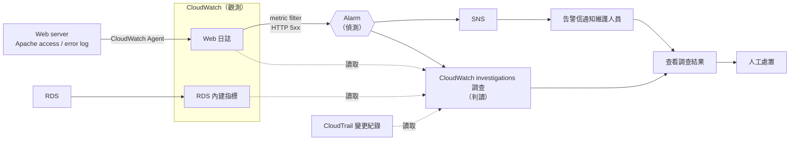

# P0-2 | WordPress Web/DB 分離（多組件經典架構）

---

## 目標

- 實現 EC2 + RDS 的 web/db 分離架構，並完成下方檢核點項目。

## 核心檢核點

1. VPC 切出 public / private 兩個 subnet
2. Web 在 public，外部瀏覽得到網站
3. DB（RDS 或自架 MySQL）在 private，外網連不到（此條最能驗證真的懂分離）
4. SG 串接：只允許 Web 的 SG 連 DB:3306
5. 發一篇文章、重整後仍在（確認寫入 DB）

## 架構說明

### 網路設定

1. 建立一個 VPC (vpc-yiweee)，CIDR 設定為 `10.0.0.0/16`。
2. VPC 下切出 public 一個、private 兩個共計三個網段，名稱分別為 subnet-yiweee-public-1a(`10.0.1.0/24`)、subnet-yiweee-private-1a(`10.0.2.0/24`)、subnet-yiweee-private-1c(`10.0.3.0/24`)。
3. public 網段的 `0.0.0.0/0` 指向 IGW，並啟動內部機器自動配發對外 IP；private 網段只有 VPC 內的 local 路由，不對外。

### 運算資源

1. 在 public 網段下，放一台 EC2 作為 Web server(機器名 ec2-yiweee，部署 WordPress)。
2. 在 private 網段下，放一台 RDS 作為 DB server(機器名 rds-yiweee，選擇 MySQL)，採用 RDS 簡化 MySQL 部署設定等繁瑣步驟。
3. Web server 的 EC2 先以本機私鑰作為登入手段，並在 Web server 上跑 MySQL client 維護。
4. RDS 需要補以下設定：

```
publicly_accessible = false             # 為了檢核點 3 的證據
skip_final_snapshot = true              # 確保 terraform destroy 可正常執行
availability_zone   = "ap-northeast-1a" # 確保 RDS 挑到 1a 的 AZ
```

5. RDS 採 single-AZ，且僅放於 subnet-yiweee-private-1a 中，subnet-yiweee-private-1c 網段只是為了滿足 DB subnet group 的要求。

### Security group 設定

1. DB server 的 inbound 只放行 3306，來源限制為 Web server 的 SG。
2. Web server 的 inbound 放行 80，來源 `0.0.0.0/0`；22，來源 `[維護人員的 IP]`。
3. DB server 和 Web server 的 outbound 先全開。

## RDS(MySQL) 與 WordPress 串接設定

1. 在 MySQL 中建立限定來源的帳號（`'wp'@'10.0.%'`，只接受 VPC 網段內的來源），並只授權 WordPress 用的資料庫。從 Web server 用 master 帳號連進去創建 `wp` 帳號。
2. 並把 WordPress 的 `wp-config.php` 中的 `DB_HOST` 指向 RDS 的 DNS 名稱(endpoint)。
3. 1 與 2 的操作放入 Web server 的 user_data 一併處理。

## Credential 管理

1. Web server 一台 EC2 的私鑰，產生後存放到 infra 的根目錄。
2. DB server 的連線密碼會在 Web server 上的 `wp-config.php` 明文儲存。
3. DB 的連線密碼(WordPress 程式透過帳號 `wp` 存取)，將用 user_data 自動寫入 Web server 的程式，且所有密碼(含 `master`、`wp` 等帳號都算)的來源寫在 `*.tfvars` 避免洩漏。因採 user_data 自動化，兩組密碼仍會以明文方式留存在 tfstate 和 Web server 的 user_data，為求整體自動化順暢，此為已知取捨。
4. 要有 `.gitignore` 避免 infra 的機密資訊如 `*.pem`、`*.tfstate*`、`.terraform/`、`*.tfvars` 被公開。

## 實作改進亮點

### ✨ 基礎設施即代碼（IaC）:

- ✅ 完整的 Terraform 配置（provider、variables、network、compute、outputs）
- ✅ 所有配置參數化，易於重複部署到多個環境
- ✅ 自動化 user_data 腳本，EC2 啟動即完成 WordPress 部署

### ✨ 安全性設計:

- ✅ 分層網路隔離（public/private 子網）
- ✅ 安全組細粒度控制（Web: 80/22、DB: 3306 from web only）
- ✅ RDS 私有部署（publicly_accessible = false）
- ✅ SSM Session Manager 支持（無需 SSH 密鑰即可連接）
- ✅ 敏感資訊管理（密碼在 tfvars，排除於 git）

### ✨ 架構設計:

- ✅ 跨 AZ 子網配置（為未來 Multi-AZ 準備）
- ✅ 自動化密碼和用戶管理（master / wp 帳號分離）
- ✅ 自動等待 RDS 就緒再配置（確保部署穩定）
- ✅ WordPress Salt Key 已設定（固定值寫在 `user_data.sh`，每次部署相同，此為已知取捨）

## 檢核點驗證步驟

以下指令都在 `infra/` 目錄下執行。

### 部署

1. 確認 `terraform.tfvars` 的 `admin_cidr` 是目前的對外 IP（`curl -s https://checkip.amazonaws.com`），`alarm_email` 是收得到信的信箱。
2. 執行 `terraform apply`，RDS 建立約需 5 到 10 分鐘。
3. 到信箱點擊 AWS Notifications 的確認連結，否則 P1-2 驗證時收不到告警信。
4. 等待 user_data 執行完成。可登入 Web server 執行 `sudo tail /var/log/cloud-init-output.log`，最後一行出現 `CloudWatch Agent setup complete!` 才算完成。

### 驗證

1. **檢核點 1**：在 AWS web console 的 VPC 頁面截圖 `vpc-yiweee`、三個 subnet、兩張 route table。`rt-yiweee-public` 要有 `0.0.0.0/0` 指向 IGW，`rt-yiweee-private` 只有 `local`。
2. **檢核點 2**：執行下列指令，第一次預期回 302 導向安裝頁。用瀏覽器完成 WordPress 安裝後再執行一次，預期回 200。

```
curl -I $(terraform output -raw wordpress_url)
```

3. **檢核點 3**：在本機執行下列指令，預期逾時。

```
nc -zv -w 5 $(terraform output -raw db_address) 3306
```

4. **檢核點 4**：
   - 正向：以 `terraform output -raw ssh_command` 取得的指令登入 Web server，執行 `nc -zv <db_address> 3306`，預期成功。
   - 反向：在 AWS web console 於 `subnet-yiweee-public-1a` 臨時起一台 EC2，掛一個新建的 SG（只放行維護人員 IP 連 22），登入後執行同一行 `nc`，預期逾時。測試完後刪除這台 EC2 與臨時 SG。
5. **檢核點 5**：在 WordPress 後台發一篇文章，然後在 Web server 執行下列指令，看得到剛發的標題即通過。

```
mysql -h <db_address> -u wp -p wordpress -e "SELECT post_title FROM wp_posts WHERE post_status='publish';"
```

## 部署資源

| 文件                                              | 說明                         |
| ------------------------------------------------- | ---------------------------- |
| 📖 [快速開始](docs/QUICKSTART.md)                 | 5 分鐘快速部署指南           |
| 📚 [詳細部署指南](docs/SETUP.md)                  | 完整的部署步驟和驗證流程     |
| 🏗️ [項目結構](docs/PROJECT_STRUCTURE.md)          | Terraform 檔案和專案組織說明 |
| 🔧 [實作調整總結](docs/IMPLEMENTATION_SUMMARY.md) | P0-2 實作調整的歷史紀錄      |
| 💻 [應用層配置](app/README.md)                    | WordPress 應用層說明         |

# P1-2 | WordPress + 維運 Agent

---

## 目標

- 實現 CloudWatch + CloudWatch investigations 資源監控流程，並完成下方檢核點項目。

## 核心檢核點

1. Agent 能讀取 Web／DB 的日誌或健康狀態
2. 重現「網站 500」或「DB 連不上」情境，Agent 能定位並給建議
3. 完整示範一次 偵測 → 判讀 → 處置
4. Agent 本身也跑在 AWS 上（EC2 或 Lambda），非只在本機執行

## 架構說明

### 流程概念

1. 資源監控流程：P1-2 沿用 P0-2 的網路、SG、RDS 設計，並在建置時納入「觀測 → 偵測 → 判讀 → 處置」的線，以下各節依這四個階段說明。檢核點中的 Agent 指的是負責判讀的維運 Agent，本階段由 CloudWatch investigations 擔任；它不是 CloudWatch Agent（後者只是把日誌搬上雲的工具）。



2. 各組件的分工：CloudWatch 負責觀測與偵測，CloudWatch investigations 負責判讀，SNS 只負責在告警當下寄信通知維護人員，處置由人執行。

### 觀測資料（Agent 讀什麼）

1. Web：在 ec2-yiweee 上安裝 CloudWatch Agent，將 Apache 的 access log 與 error log 送進 CloudWatch Logs。
2. DB：直接使用 RDS 內建指標（連線數、CPU 等）與 instance 狀態，不開啟 RDS 的 log 匯出。本階段的故障情境（見「故障情境設計」）是在 SG 層擋掉連線，請求到不了 MySQL，RDS log 不會有紀錄，因此不需為此更動 RDS。
3. 因此建置上只有 Web server 需要更動，新增三項：IAM role 的 CloudWatch 寫入權限、user_data 安裝 CloudWatch Agent、`wp-config.php` 開啟 `WP_DEBUG`（不顯示在頁面上），讓連不上 DB 等錯誤寫進 Apache error log 供 Agent 判讀。

### 偵測（何時叫醒 Agent）

1. 設定 metric filter 將 Apache 的 access log 中的 HTTP 5xx 轉成指標，超過門檻即觸發 Alarm。在本階段的故障情境下（見「故障情境設計」），每個請求都須等到逾時才產生一筆 500，所以門檻要低到零星幾筆就觸發。
2. 網站沒有請求時不會產生日誌，指標也就沒有資料，Alarm 預設會把這種情況標成 INSUFFICIENT_DATA 而不是 OK，這是預期狀態，不是錯誤。也因為沒有請求就沒資料，驗證時需要自行發出請求來產生 5xx，否則不會觸發 Alarm。
3. Alarm 觸發時同時做兩件事：啟動 CloudWatch investigations 調查、發到 SNS 寄信給維護人員。兩者平行進行，告警信寄送時調查通常尚未完成。
4. 告警信只有告警本身的資訊（名稱、狀態變化、門檻），沒有日誌內容與分析。因此在告警描述中寫明「CloudWatch investigations 已自動開始調查」與調查頁面的位置，讓維護人員知道下一步去哪裡看。
5. 只做 HTTP 5xx 這一條告警。CPU／記憶體／磁碟告警與 Dashboard 不在檢核點範圍內，先不做。

### 判讀（Agent 本體）

1. 維運 Agent 本體是 CloudWatch investigations（原為 Amazon Q Developer Operational Investigations）。在帳號內建立一個 investigation group，並把它設為 Alarm 的 action，Alarm 一響就自動開始調查。
2. CloudWatch investigations 會自行掃描相關的日誌、指標與 CloudTrail 的變更紀錄，產出「根因假設 + 建議處置」。
3. 帳號內還有其他專案的資源，因此所有資源都帶上 `Project = yiweee` 標籤，並在 investigation group 以這個標籤劃定範圍，讓調查能辨識哪些資源屬於同一個系統。
4. 調查結果在 CloudWatch 的 investigations 頁面查看，不會主動寄給維護人員。
5. 本階段為了更加活用既有的 AWS 服務，採用 CloudWatch investigations，Agent 本體就是 AWS 上的受管服務，已符合「非只在本機執行」的要求，因此不另外採 Bedrock/LangChain + Lambda 自建 Agent。

### 處置

1. Agent 只讀不改：維護人員收到告警信後，到 CloudWatch 查看 investigations 的調查結果，由人依建議執行處置。
2. 不做自動修復：自動改 SG 或重啟服務需要寫入權限，誤判的代價高，而檢核點 3 只要求完整示範一次流程，此為已知取捨。

## 故障情境設計

1. 主情境選「DB 連不上」：手動移除 DB SG 的 3306 inbound 規則。
2. WordPress 連不上 DB 時會回 HTTP 500，因此一個情境同時涵蓋「網站 500」與「DB 連不上」兩種症狀。
3. 選這個做法的理由：不需停 RDS（停止與啟動各要數分鐘）、用 `terraform apply` 即可還原。
4. 移除 SG 規則後封包會被丟棄但不會拒絕連線，WordPress 會卡到連線逾時後才回 500，實測每個請求約等 60 秒。
5. 預期的判讀路徑：Web 日誌出現 500 → RDS 本身狀態正常 → CloudTrail 的變更紀錄顯示 DB SG 剛被移除 3306 規則。

## 權限與 Credential 管理

1. 全部透過 IAM role 授權，P1-2 不新增任何長期金鑰或密碼。
2. Web server 的 role 新增 `CloudWatchAgentServerPolicy`，只為了寫入日誌。
3. CloudWatch investigations 調查使用獨立的 role（由 `aiops.amazonaws.com` 擔任），只有唯讀權限，沒有任何修改資源的權限。
4. investigation group 要允許 Alarm 建立調查。
5. SNS 告警信箱訂閱需要人工點確認信，且告警信箱應寫在 `*.tfvars`，沿用 P0-2 的 `.gitignore`。
6. Log group 設定保留天數，避免日誌（含訪客 IP）無限累積。

## 檢核點驗證步驟

四個檢核點是同一次故障演練從不同角度取證，依下列順序做一次即可全部涵蓋。本節可獨立執行，不需先做過 P0-2 的驗證；以下指令都在 `infra/` 目錄下執行。

### 部署

已依 P0-2 的步驟部署並完成 WordPress 安裝者，可直接跳到「演練前確認」。

1. 確認 `terraform.tfvars` 的 `admin_cidr` 是目前的對外 IP（`curl -s https://checkip.amazonaws.com`），`alarm_email` 是收得到信的信箱。
2. 執行 `terraform apply`，RDS 建立約需 5 到 10 分鐘。
3. 到信箱點擊 AWS Notifications 的確認連結，否則收不到告警信。
4. 等待 user_data 執行完成。以 `terraform output -raw ssh_command` 取得的指令登入 Web server，執行 `sudo tail /var/log/cloud-init-output.log`，最後一行出現 `CloudWatch Agent setup complete!` 才算完成。
5. 用瀏覽器開啟 `terraform output -raw wordpress_url` 的網址，完成 WordPress 安裝。未安裝時首頁只會回 302 導向安裝頁，演練最後無法以 `200` 確認恢復。

### 演練前確認

1. 發一次請求，預期回 `200`，同時在 access log 留下一筆紀錄：

```
eval "$(terraform output -raw fault_probe_command)"
```

2. CloudWatch 的 log group `/yiweee/web/apache/access` 裡有一條以 instance ID 命名的 log stream，且看得到上一步的請求。日誌送達約需一分鐘。
3. Alarm `alarm-yiweee-http-5xx` 的狀態是 INSUFFICIENT_DATA（預期狀態）。

### 演練

1. 注入故障並記下時間：

```
eval "$(terraform output -raw fault_inject_command)"
```

2. 發出請求產生 500。每次請求約等 60 秒才回 `500`，可多發幾次：

```
eval "$(terraform output -raw fault_probe_command)"
```

3. 確認偵測：Alarm 在一兩分鐘內轉為 ALARM，信箱收到告警信。
4. 查看判讀：到 CloudWatch 的 investigations 頁面，會有一筆由 Alarm 自動建立的調查，等待調查完成後截圖。
   - **檢核點 1**：調查引用的 Web 日誌與 RDS 指標。若未自動引用，在調查中手動加入 log group 與 RDS 指標。
   - **檢核點 2**：根因假設（預期指向 DB 連線失敗與 DB SG 的 3306 規則被移除）與建議處置。
   - **檢核點 4**：investigation group `ig-yiweee` 與這筆由 Alarm 觸發的調查紀錄。
5. 處置並確認恢復：執行 `terraform apply` 還原 3306 規則，再執行一次步驟 2 的指令，預期回 `200`。
6. **檢核點 3**：將步驟 1 到 5 的時間點整理成時間軸。

### 清理

1. 到 CloudWatch 的 investigations 頁面，把所有調查結束並封存。investigation group 內還有進行中的調查時無法刪除，而 `terraform destroy` 不會回報這個錯誤，殘留的 group 會讓下次 `terraform apply` 失敗。
2. 執行 `terraform destroy`，避免 RDS 與 EC2 持續計費。

## 部署資源

| 文件                                                             | 說明                                                                       |
| ---------------------------------------------------------------- | -------------------------------------------------------------------------- |
| 📝 [`infra/monitoring.tf`](infra/monitoring.tf)                  | 觀測與偵測：Log group、metric filter、Alarm、SNS                           |
| 📝 [`infra/agent.tf`](infra/agent.tf)                            | 維運 Agent：CloudWatch investigations 的 investigation group 與其 IAM role |
| 🔧 `infra/compute.tf`、`infra/user_data.sh`                      | Web server 的 IAM 權限、CloudWatch Agent 安裝與 `WP_DEBUG`                 |
| 🔧 `infra/provider.tf`                                           | 新增 `awscc`、`time` provider 與 `default_tags` 的 `Project` 標籤          |
| 🔧 `infra/variables.tf`、`infra/outputs.tf`                      | 新增 `alarm_email`、`log_retention_days`，以及故障注入與驗證用的指令輸出   |
| 📖 [CloudWatch 練習](practice/cloudwatch/CLOUDWATCH_PRACTICE.md) | CloudWatch 操作練習紀錄                                                    |
